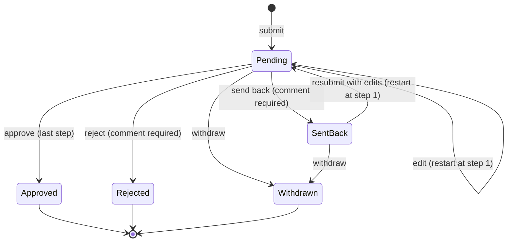

# Design – Purchase Exception Requests

A short design note. It implements [requirements.md](requirements.md), and IDs like **A2** or **US-7** refer to that file.
Goal: **the smallest design that meets every Must requirement and the kickoff concerns.**

## 1. Big picture

```
React (Vite)  ──HTTP /api──►  Express  ──►  workflow.js (plain rules)  ──►  SQLite
 user switcher                 auth.js  (who is the user?)
                               routes   (load data → ask workflow → save in one transaction)
```

| Piece | File(s) | Job |
|---|---|---|
| Identity | `server/src/auth.js` | The **only** code that decides who the current user is. |
| Rules | `server/src/workflow.js` | Plain functions: build the approval route, check who may act, decide the next status. No Express or SQL, so it's easy to test. |
| Database | `server/src/db.js` | Creates tables and triggers, runs queries. |
| API | `server/src/routes.js` | Thin HTTP layer: validate input → call workflow → save + write history in one transaction. |
| UI | `client/src/` | Screens. Hides buttons the user can't use, but **the server enforces every rule.** |

## 2. Data model (5 tables)

```
departments 1───* users *───1 users (manager)
                    │  └───1 users (delegate)
                    │
users 1───* requests 1───* approval_steps
                     1───* request_history   (append-only)
```

### `departments`
| Column | Type | Notes |
|---|---|---|
| id | INTEGER PK | |
| name | TEXT | e.g. Operations |
| director_id | → users.id | The director who approves stage 2 (A4) |

### `users`
| Column | Type | Notes |
|---|---|---|
| id | INTEGER PK | |
| name, email | TEXT | Synthetic. `email` is what Microsoft sign-in will match on later. |
| role | TEXT | `employee` · `manager` · `director` · `vp_finance` · `cfo` · `finance` |
| department_id | → departments.id | |
| manager_id | → users.id, nullable | Who they report to. Drives stage 1 of the route. |
| delegate_id | → users.id, nullable | **Set = "I'm away, this person covers me."** (F1) |

### `requests`
| Column | Type | Notes |
|---|---|---|
| id | INTEGER PK | Shown as e.g. PE-0007 |
| requester_id | → users.id | |
| vendor, category, justification | TEXT | category: Rush order / Repair / New vendor / Other (A6) |
| amount_cents | INTEGER | Whole cents, no floating-point rounding. $1,250.50 → 125050 |
| status | TEXT | See §3 |
| current_step | INTEGER, nullable | Which approval step is active (1, 2, 3). Null when not Pending. |
| waiting_since | TEXT (ISO time) | When the current step started. Gives "days waiting" (F4). |
| version | INTEGER | +1 on every change. Stops two people acting on an outdated screen (see §5). |
| created_at, updated_at | TEXT | |

### `approval_steps` – the route for the current round
| Column | Type | Notes |
|---|---|---|
| request_id | → requests.id | |
| step_no | INTEGER | 1, 2, 3 in order |
| level | TEXT | `manager` · `director` · `vp` (which rule put them here) |
| approver_id | → users.id | |

This is **working state**, not the audit record. When a request is edited or resubmitted, its steps are rebuilt for the new amount (D2). Everything that *happened* lives in `request_history`.

### `request_history` – the audit trail (Priya)
| Column | Type | Notes |
|---|---|---|
| id | INTEGER PK | |
| request_id | → requests.id | |
| action | TEXT | `submitted` · `edited` · `resubmitted` · `approved` · `rejected` · `sent_back` · `withdrawn` |
| actor_id | → users.id | Who clicked |
| on_behalf_of_id | → users.id, nullable | Set when a delegate acted (F3) |
| comment | TEXT, nullable | Required for reject / send back |
| changes | TEXT (JSON), nullable | For edits: `{"amount_cents": [90000, 900000]}` (old → new) (E2) |
| created_at | TEXT | Set by the database |

**Append-only, enforced by the database (E3):**
```sql
CREATE TRIGGER history_no_update BEFORE UPDATE ON request_history
BEGIN SELECT RAISE(ABORT, 'request_history is append-only'); END;
CREATE TRIGGER history_no_delete BEFORE DELETE ON request_history
BEGIN SELECT RAISE(ABORT, 'request_history is append-only'); END;
```

### Seed data (synthetic)

| Name | Role | Department | Reports to | Why they exist in the demo |
|---|---|---|---|---|
| Elena Marsh | cfo | Finance | — | Approves the VP's own requests (B4). Top of the org, so can't submit |
| Victoria Hale | vp_finance | Finance | Elena | Stage 3 for $10k+, can see everything |
| Dana Whitfield | finance | Finance | Victoria | Read-only company-wide view |
| Daniel Ortiz | director | Operations | Victoria | Director of **both** Operations and Warehouse (stage 2) |
| Morgan Lee | manager | Operations | Daniel | Manager (stage 1) |
| Jordan Blake | manager | Warehouse | Daniel | Second manager, and a backup (delegate) for Morgan |
| Alex Chen | employee | Operations | Morgan | Operations requester |
| Taylor Brooks | employee | Warehouse | Jordan | Warehouse requester, so department filters have data |

Seven users were asked for in Step 4: two employees, two managers, one director, the VP of Finance and one finance viewer. (An earlier draft had a second director and a third employee; they were cut to keep the demo small.) The CFO was added later so the VP's own requests have an approver (B4). Finance's director is Victoria, so Victoria's requests skip up to Elena at every stage.

Sample requests in different statuses are added once the workflow rules exist (Step 5), so they're created through the same rules as real ones.

## 3. Statuses and transitions



| From | Action | Who | To | History entry |
|---|---|---|---|---|
| — | submit | anyone with a manager, except finance viewers | Pending, step 1 | submitted |
| Pending | approve | current approver or their delegate, if they haven't approved another stage (B5) | Pending, next step **or** Approved | approved |
| Pending | reject + comment | current approver or their delegate | Rejected | rejected |
| Pending | send back + comment | current approver or their delegate | Sent back | sent_back |
| Pending | edit | requester | Pending, **step 1**, route rebuilt | edited (with changes) |
| Sent back | edit = resubmit | requester | Pending, **step 1**, route rebuilt | resubmitted (with changes) |
| Pending / Sent back | withdraw | requester | Withdrawn | withdrawn |
| Approved / Rejected / Withdrawn | anything | anyone | **refused** (locked, D4) | — |

### Building the route (A1–A4, B1–B4)

```
levels needed:  amount < $1,000           → [manager]
                $1,000 ≤ amount < $10,000 → [manager, director]
                amount ≥ $10,000          → [manager, director, vp]

for each level:
  person = manager → requester's manager
           director → director of requester's department
           vp → the VP of Finance
  while person is the requester: person = person's manager   (B1, B3: never approve your own)
  if no person found: refuse with "no eligible approver"      (B4)
if that person is already in the route: don't add them again, just raise their
  step to this higher level (one approval covers both stages, B2)
```

The two thresholds live in one constant in `workflow.js` (`THRESHOLDS = { director: 100000, vp: 1000000 }` in cents), so changing them is one line.

**Examples:** Alex $500 → Morgan. Alex $5,000 → Morgan → Daniel. Alex $14,000 → Morgan → Daniel → Victoria.
Morgan $5,000 → Daniel (Morgan's manager *is* the director, so only one step). Daniel $5,000 → Victoria (Daniel can't approve himself, so it skips up).
Victoria, any amount → Elena (the CFO). Elena → refused: nobody above her.

### Who may act on the current step

```
canAct(user, request) =
     request.status is Pending
 AND user is not the requester                         (no self-approval, even as a delegate)
 AND user.role is not 'finance'                        (finance is read-only)
 AND (user is the step's approver
      OR the step's approver has delegate_id = user)   (vacation cover)

approve also needs (B5, one person = one stage):
     user has not approved any stage since the last submit/edit
 AND if acting as a backup: user is not the approver of a later stage
```

"Since the last submit/edit" is worked out from `request_history`, so it needs no extra column.

## 4. API outline

All endpoints are under `/api`. The demo client sends `X-User-Id`, and `auth.js` turns it into `req.user`.
Errors return `{ "error": "message" }` with **400** invalid input · **401** no user · **403** not allowed · **404** not found · **409** wrong status or outdated version.

| Method & path | Who | Purpose |
|---|---|---|
| `GET /api/users` | anyone (no auth) | List demo users for the switcher. Would be removed with real sign-in. |
| `GET /api/me` | signed in | Current user, including role and delegate |
| `PUT /api/me/delegate` | approvers | `{ delegateId }` sets a backup, `null` clears it (US-13) |
| `GET /api/departments` | signed in | For the filter dropdown |
| `GET /api/requests?view=mine` | signed in | My requests (US-9) |
| `GET /api/requests?view=inbox` | approvers | Waiting on me or someone I cover (US-10) |
| `GET /api/requests?view=reviewed` | approvers | Requests I approved, rejected or sent back, or my backup did for me (G1) |
| `GET /api/requests?view=all&q=&status=&department=` | finance, vp_finance | Company-wide, searchable and filterable (US-12) |
| `GET /api/requests/:id` | requester, anyone in its route, finance, vp_finance | Details + route + full history |
| `POST /api/requests` | not finance | Submit (US-1) |
| `PUT /api/requests/:id` | requester | Edit or resubmit. Body includes `version` (US-7) |
| `POST /api/requests/:id/approve` | current approver/delegate | `{ version, comment? }` |
| `POST /api/requests/:id/reject` | current approver/delegate | `{ version, comment }` (comment required) |
| `POST /api/requests/:id/send-back` | current approver/delegate | `{ version, comment }` (comment required) |
| `POST /api/requests/:id/withdraw` | requester | `{ version }` |

List rows include: id, requester, department, vendor, amount, status, current approver name, delegate name (if covering), days waiting.

## 5. How each kickoff concern is handled

| Concern | Who | Design answer |
|---|---|---|
| **Vacations** – requests sit for a week | Marcus | `users.delegate_id`. While set, the delegate sees the approver's waiting requests in their inbox and can act on them. Delegation is checked **when someone acts**, not copied into the route, so clearing it hands everything straight back. History records "Jordan Blake on behalf of Morgan Lee". The finance list shows **days waiting**, so stuck requests stand out. |
| **Audit history** – who approved what and when, unchangeable | Priya | Every action writes one `request_history` row **in the same transaction** as the status change, so you never get one without the other. Database triggers reject UPDATE/DELETE on that table, so even a code bug can't rewrite history. Edits store old → new values. A `version` number stops someone approving a request that changed after they opened it (409, "this request changed, please reload"). |
| **Microsoft sign-in later** | Tom | `auth.js` is the only place that knows *how* a user is identified. Today it reads `X-User-Id`. Later it validates a Microsoft (Entra ID) token and looks the user up by `email`. Routes and rules only use `req.user`, so they don't change. The user switcher and `GET /api/users` get removed. |
| **Finance is read-only** | Dana | Role `finance` can use `view=all` and open any request. `canAct` refuses role `finance` on the server, and the UI doesn't show the buttons. |
| **No approving your own request** | Dana | The route builder never puts the requester in their own route (it skips up to the next manager). `canAct` checks again, which also covers the case where someone is the *delegate* for an approver on their own request. |
| **Editing requests** | Dana | The requester can edit while Pending or Sent back, using a normal form. Every edit rebuilds the route for the new amount and **restarts at step 1**, so an approval given for $900 can't carry over to $9,000. Approved/Rejected/Withdrawn are locked. |

## 6. Testing plan

- **`workflow.test.js`** (no HTTP): routing at $999.99 / $1,000 / $9,999.99 / $10,000 · manager and director submitting (skip-up, de-dupe) · no eligible approver · approve to next step / to Approved · reject and send back require comment · edit restarts at step 1 and reroutes · locked statuses · finance can't act · delegate can act · delegate can't act on own request.
- **API tests** (real Express + in-memory SQLite): permission checks return 403 · version conflict returns 409 · every action adds exactly one history row · **UPDATE/DELETE on history fails at the database level**.

## 7. Deliberately left out

No separate "Draft" status (submit is one step) · no attachments · no email notifications or auto-escalation · no admin screens (users come from seed data) · no pagination (demo-sized data). See requirements §6.
